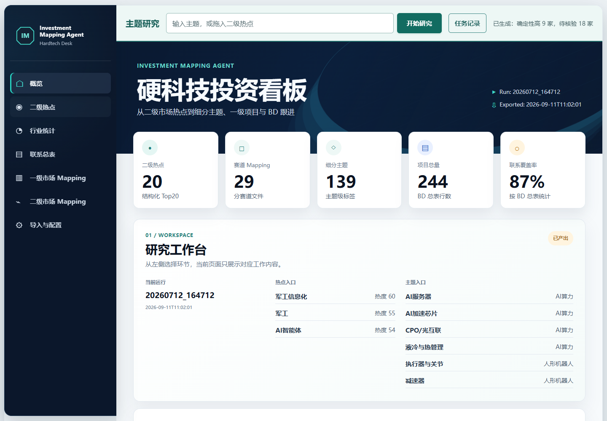
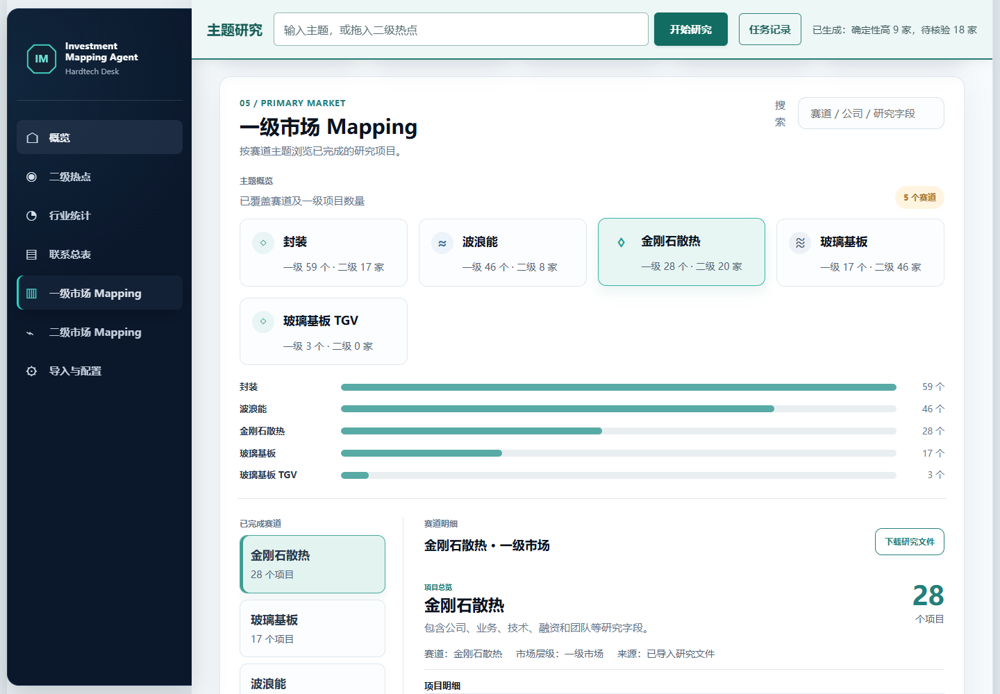
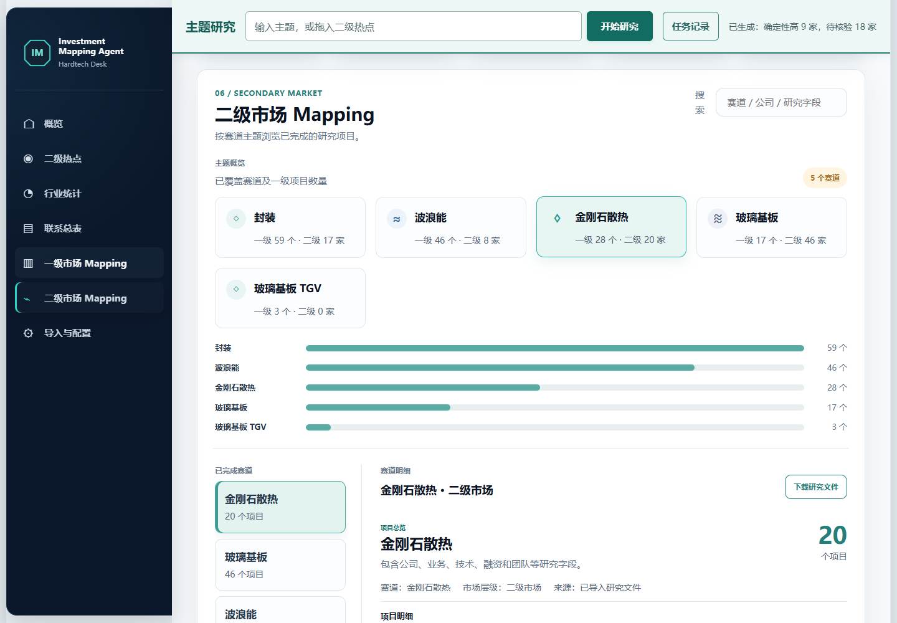
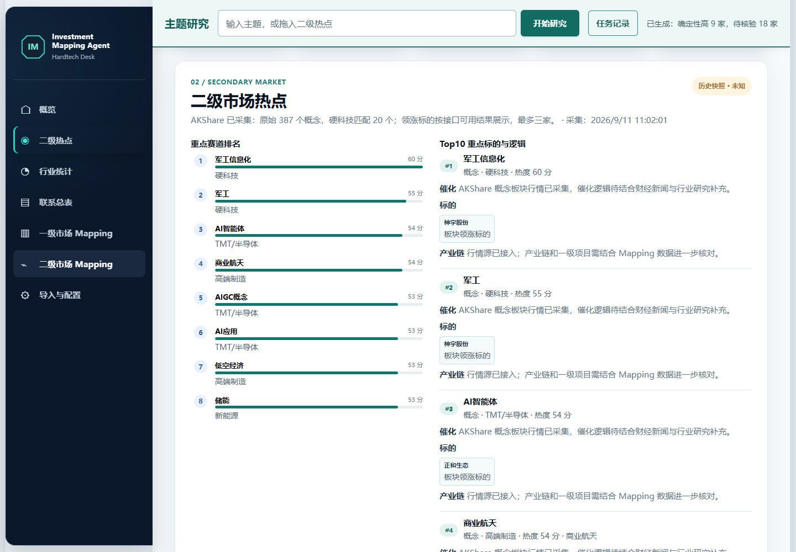

# Mapping Agent · 硬科技投资研究看板

将二级市场主题、一级项目研究、Excel Mapping 和联系跟进放在同一个工作台。

[项目介绍](#项目介绍) · [功能与部署](#功能与部署) · [技术版 PRD](docs/PRD_V1_1.md) · [使用指南](docs/USER_GUIDE.md)

## 项目介绍

### 解决什么问题

在一级市场投资研究中，Mapping 是围绕一个赛道并列比较企业业务、技术、团队、融资等信息的研究方法。传统工作往往分散在行情网站、搜索结果、多个 Excel 和联系记录中，容易重复搜索、遗漏来源，也难以统一展示进展。

Mapping Agent 面向硬科技投资研究和项目拓展，将这些环节连接起来：从二级热点找到研究方向，通过 GLM 与公开搜索发现一级企业，生成可复核的标准 Excel，再将研究结果和已有资料放入看板管理。它也支持直接上传已经完成的 Mapping，不要求从头重新研究。

**产品定位：本地可运行的研究辅助工具，不是自动投资决策系统，也不是保证穷尽全市场的付费企业数据库。**

### 两条工作流

```text
从零研究
二级热点 / 输入主题 → GLM 拆解关键词 → 公开搜索 → 企业抽取与核验
                   → 确定性高 / 待核验 Excel → 确认发布 → 一级 Mapping

已有成果
上传 Mapping Excel → 规则解析原始字段 → 持久存储 → 一级 / 二级 Mapping
                   → 联系信息补充 → BD 跟进与覆盖统计
```

新研究不会读取已导入的 Excel 来冒充新产出。来源不足时字段留空；上市状态不清楚或证据薄弱的候选进入“待核验”，不会为满足数量而补造企业。

### 界面预览

以下图片来自本地实际运行页面，截图日期为 **2026-10-22**，不是设计稿。项目数量来自本地已导入资料；截图日期不等于行情日期，行情新鲜度以页面中的采集时间、核验日期和失败提示为准。截图不展示私人联系方式或 API Key。

**研究概览：** 顶部研究入口跨页面保留，左侧统一导航，主体展示研究覆盖与进展。



**一级市场 Mapping：** 按研究主题浏览项目，保留原始 Excel 的研究字段和类型标签。



<details>
<summary>查看二级市场 Mapping 和热点页面</summary>

**二级市场 Mapping：** 与一级项目分开展示，作为业务与技术路线的对照。



**二级热点：** 展示公开概念行情与参考标的，可将主题拖入顶部研究区。免费数据源失败或仅部分可用时保留提示。



</details>

### 技术实现概览

| 层次 | 当前实现 | 作用 |
| --- | --- | --- |
| 前端 | HTML、CSS、原生 JavaScript、hash 路由 | 七个页面、主题切换、筛选、拖放、任务进度和图表 |
| 后端 | Python `ThreadingHTTPServer` | 提供页面、上传下载接口和后台任务入口 |
| 研究编排 | 显式阶段状态、后台线程、有限并发 | 规划、搜索、抽取、核验、合并、导出和发布 |
| 大模型 | GLM 对话 API + 智谱 Web Search | 扩展关键词、来源约束抽取、中英文别名判断 |
| 行情 | AKShare 数据源适配器 | 概念、个股行情、财务、主营和新闻，记录失败状态 |
| 文件 | openpyxl | 读取已有 XLSX、生成标准研究 Excel |
| 存储 | SQLite + JSON + 原始 Excel | 保存项目、前端快照、研究证据和下载文件 |

当前不是 LangChain/LangGraph 多 Agent 系统，未使用 MCP 作为运行依赖，也没有向量数据库。模型参与语义理解，Python 负责流程控制、结构校验和存储。详细方法与限制见[技术版 PRD](docs/PRD_V1_1.md)。

## 功能与部署

### 功能入口

| 页面 | 可以做什么 |
| --- | --- |
| 概览 | 查看研究主题、项目数量、联系覆盖与整体进展 |
| 二级热点 | 浏览概念行情、参考标的和可用财务资料，选择新研究方向 |
| 行业统计 | 按行业汇总热点、项目数量和联系覆盖 |
| 联系总表 | 筛选公司，查看研究信息、公开联系方式和已有跟进记录 |
| 一级市场 Mapping | 按主题查看未上市项目研究、类型标签和来源文件 |
| 二级市场 Mapping | 独立查看上市公司研究，切换赛道并下载文件 |
| 导入与配置 | 上传已有 Mapping，查看任务及接口配置状态 |

### 1. 环境准备与首次启动

建议使用 **Python 3.12 + Git + 现代浏览器**。当前上传模块依赖 `cgi`，不要未经适配直接切换至 Python 3.13。请在虚拟环境中安装依赖，避免系统 Python、pip 与网站实际运行环境不一致。

仓库若为 Private，需要先使用有权限的 GitHub 账号完成 Git 认证；不要将访问令牌写进克隆 URL。

**Windows / PowerShell：**

```powershell
git clone https://github.com/carpediem128/Mapping-Agent.git
cd Mapping-Agent
py -3.12 -m venv .venv
.\.venv\Scripts\python.exe -m pip install -r requirements.txt
.\.venv\Scripts\python.exe -m web_server_v1
```

**macOS / Linux：**

```bash
git clone https://github.com/carpediem128/Mapping-Agent.git
cd Mapping-Agent
python3.12 -m venv .venv
.venv/bin/python -m pip install -r requirements.txt
.venv/bin/python -m web_server_v1
```

打开 **http://127.0.0.1:4173/**。不要双击 `web/index.html`，上传、研究任务和数据库写入需要 Python 服务。终端保持运行；按 `Ctrl+C` 停止服务。

端口被占用时先换端口，不必关闭其他应用：

```powershell
$env:MAPPING_PORT = '4174'
.\.venv\Scripts\python.exe -m web_server_v1
```

此时访问 `http://127.0.0.1:4174/`。默认仅监听本机地址，不是公网网址。

### 2. 配置 GLM 与修改模型

浏览已有资料不需要大模型 Key。从零研究需要自己的智谱 Key，同时具备对话模型和 Web Search 权限；费用由供应商账户承担。

在启动服务的同一个 PowerShell 窗口设置：

```powershell
$env:GLM_API_KEY = '<your-own-key>'
$env:GLM_MODEL = '<model-enabled-in-your-account>'
.\.venv\Scripts\python.exe -m web_server_v1
```

`GLM_MODEL` 可省略，使用配置中的默认模型。macOS/Linux 使用 `export GLM_API_KEY='...'` 和 `export GLM_MODEL='...'` 后启动。实际模型名称应以自己账户已开通的型号为准。

配置文件为 [`config/default_config.json`](config/default_config.json)：`glm.model` 设置默认模型，`glm.base_url` 设置接口地址，默认 `https://open.bigmodel.cn/api/paas/v4`。环境变量 `GLM_MODEL` 优先于配置文件。更换环境变量后重启服务。

以下命令只显示配置状态，不输出 Key：

```powershell
.\.venv\Scripts\python.exe -c "from agent.settings import load_config; from agent.sources.glm import GLMClient; print(GLMClient.status(load_config()))"
```

**不要把真实 Key 写进 README、源码、前端、Excel 或上传 GitHub。** 当前说明使用的是环境变量，不应假定创建 `.env` 就会自动加载。交付时让每位使用者配置自己的 Key；曾泄露的 Key 应在供应商处撤销并轮换，删除文件不能撤销已经泄露的凭据。

### 3. 从一个主题生成 Mapping

1. 在顶部输入主题，例如“玻璃基板 TGV”，或将二级热点拖入研究区。
2. 点击“开始研究”，后台依次拆解关键词、搜索公开材料、发现企业并补查团队、技术和融资。
3. 在任务记录中查看进度、来源和结果；切换页面不会取消任务。
4. 完成后下载 Excel，人工检查“确定性高”和“待核验”两个 Sheet。
5. 点击“加入 Mapping 看板”，将确定性高项目加入一级 Mapping；下载文件本身不会自动发布。

标准12列：公司类型、公司名称、地区、成立时间、业务描述、核心产品/技术、融资轮次、最新融资金额、主要投资方、公司团队、公司简介、联系方式。

每个非空抽取字段须引用已有搜索来源；别名合并保留依据，不直接按名称相似度合并母子公司。Excel 不逐单元格加批注，每张表末尾保留一句备注；详细来源仍保存在任务证据中。研究阶段联系方式默认留空，另行补充。

默认最多补查30个候选，同时最多两个研究任务。确定性高不等于已完成尽调；服务重启时未完成任务标记为中断，不支持完整断点续跑。不要为了看截图或浏览页面反复点击研究按钮，这会实际调用收费接口。

### 4. 导入已有 Excel 与下载

打开“导入与配置”，选择一个或多个 `.xlsx` 并上传。系统先保存文件，再后台解析入库，联系方式补充随后进行。导入已有成果不需要先调用 GLM。

推荐文件名 `YYMMDD_主题_Mapping.xlsx`，第一行是表头，公司列使用“公司名称”或“企业名称”，Sheet 规范命名为“一级市场”“二级市场”。原始类型标签、研究字段、Sheet 与行号会保留。

上传使用 `FormData → POST /api/import-mappings`；后端用 openpyxl 将每行转成字段字典，并输出到 SQLite 与前端 JSON。它不是任意 Excel 的语义识别器，多行标题、合并表头和未缓存公式需要预处理。

同名来源在前端会被替换，数据库按记录标识 upsert；改名重复上传、原文件删行后的数据库清理仍需注意，不能当作全局企业去重。原始文件下载位于各主题页，研究文件通过任务下载接口交付。

### 5. 行情、联系方式与数据可信度

AKShare 无需大模型 Key。网站运行期间每30分钟检查刷新；关闭服务或电脑休眠后不会继续采集。采集时间与行情日期分别保存，无法核验日期时明确提示，免费接口不保证持续可用。

手动检查依赖或刷新：

```powershell
.\.venv\Scripts\python.exe -m pip install --upgrade -r requirements.txt
.\.venv\Scripts\python.exe -c "import akshare; print(akshare.__version__)"
.\.venv\Scripts\python.exe -m scripts.refresh_market_data_enhanced
```

周期日志在 `runs/market_refresh/`。主源失败会尝试备用数据或保留历史快照；页面出现“部分更新”不表示所有价格、财务和领涨标的都已刷新。不要将历史快照当作实时行情。

联系方式补充由 `external_contact_crawler_path` 配置的外部爬虫提供，接口为 `crawl_company(...)`。未安装或未配置爬虫时不能自动完成全网联系信息采集。优先使用上传资料、官网及公开招聘信息，保存来源证据；早期招聘联系人不能仅凭发布日期推断为创始人。不会自动向联系人发送消息。

### 6. 数据存储、备份和多人部署

| 位置 | 内容 |
| --- | --- |
| `web/data/mapping.db` | SQLite 项目记录，不需要数据库订阅 |
| `web/data/mapping_sources.json` | 原始字段、Sheet 和来源记录 |
| `web/data/site_data.json`、`site_data.js` | 浏览器展示所用的统计与数据快照 |
| `runs/topic_research/<ID>/` | 任务状态、检索响应、证据和生成的 Excel |
| `web/artifacts/` | 页面可下载的文件副本 |

页面读取 JSON，而不是每次筛选都执行数据库 SQL。SQLite 和多个 JSON 尚不是跨文件事务一致的系统；并发写入需谨慎。备份前先停止服务，再复制 `web/data/`、`runs/` 和 `web/artifacts/`，同时保留原始 Excel。不要将含私人联系方式、研究数据或密钥的备份随代码上传。

当前适合本地运行。**Vercel 静态托管不能直接代替本项目的常驻 Python 服务、后台线程和可写 SQLite。** 外网团队部署需要持久磁盘、HTTPS、身份认证、文件访问权限、上传大小限制与备份机制；当前 `web/data/` 可能通过静态服务暴露，不要直接开放到公网。

项目有 PostgreSQL 适配模块，但快速导入仍直接使用 SQLite，不能只配置 `DATABASE_URL` 就视为全链路迁移完成。

### 7. 源码结构与验证

```text
agent/                 研究编排、模型客户端、核验、导出与行情适配
server/                上传、下载、任务查询和发布接口
web/                   HTML / CSS / JavaScript 与展示数据
config/                行业关键词、模型和数据源配置
scripts/               导入、刷新、测试与截图脚本
docs/                  PRD、使用指南与真实页面截图
runs/                  本地执行结果和证据（默认忽略）
web_server_v1.py        正式网站启动入口
run_agent.py           命令行入口
requirements.txt       Python 依赖
```

在仓库根目录执行不调用收费研究接口的单元测试：

```powershell
.\.venv\Scripts\python.exe -m unittest scripts.test_market_runtime scripts.test_topic_research scripts.test_research_export
```

维护者更新截图时，先启动网站，再在装有 Node.js、Playwright 和 Edge 的开发环境中运行 `node scripts/capture_readme.cjs`；它只浏览页面，输出 `docs/images/`，不发起新研究。七页交互回归脚本为 `scripts/check_research_ui.cjs`。正式运行网站不依赖 Node.js。

常见问题：页面打不开时先确认 Python 服务和端口；401/403 检查模型或搜索权限；金额与报告期缺失时检查数据源，不用模型猜测；上传很久时查看后台任务及爬虫配置，避免重复提交。

更多说明：[技术版 PRD](docs/PRD_V1_1.md) · [使用指南](docs/USER_GUIDE.md) · [数据库工作流](docs/DATABASE_WORKFLOW.md) · [行情刷新说明](docs/MARKET_DATA_REFRESH.md)。
