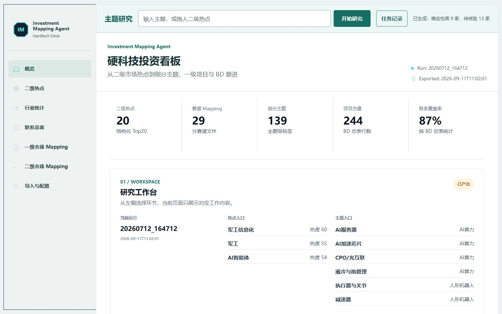

# Deal Sourcing 执行与验证

十二条路径现在进入实际查询队列，重点六条先执行。每个搜索网址保留全部命中查询，避免去重丢失反向搜索路径。公司抽取扩展到技术路线、客户、市占率、收入利润、产能良率、估值、股权、行业变化、投资逻辑与待验证问题；非空字段仍须引用当前任务的证据编号。

任务生成 `sourcing_report.json`，记录路径执行状态、搜索失败、来源数、来源编号、各公司发现路径及缺失字段。覆盖统计表示执行和返回情况，不证明穷尽行业，也不把转载当独立验证。

原有两张十二列工作表保留。新任务额外输出“检索执行”和“投资研究”Sheet。页面任务记录增加检索覆盖与人工二维筛选，分别选择投资吸引力、交易可行性的高低，映射到四类跟进建议。人工选择仅保存在当前浏览器；Excel 保留生成时待判断状态，不声称多人同步或自动尽调。

Growth 与 Buyout 的问题集保存在研究计划中。当前没有用缺失财务、估值、退出意愿的记录自动打分，短名单由使用者评估形成。搜索 API 的调用失败保留在覆盖报告中。

界面参考 Taste Skill 的 app screen 方向：降低装饰和阴影、统一表格层级、让颜色服务于状态与选择。七个导航和已有接口未变更。

## 2026 年 11 月 3 日验证

真实主题“光芯片 1.6T光模块”完成了 58 次查询、369 条来源记录和 30 份企业抽取，生成确定性高 9 家、待核验 13 家。十二条路径均有执行记录与返回来源。文件包含原两张模板表及检索执行、投资研究两张附表。来源数包括转载，分层不等于尽调结论。本轮期间补充的候选均衡策略另以本次 discovery 和 evidence 做回放并通过单元测试；不将回放称作第二次联网研究。

17 项 Python 测试通过。七页导航、热点拖放、输入保留、人工筛选和手机菜单均通过浏览器测试。Taste Skill 选用 framed-sheet 方向并在 1440、1024、390 三种宽度运行检查，结果为零失败、零警告。密钥、原始任务证据及私人研究资料不随代码提交。

该截图中的行情仍为历史快照；本次检索升级不表示已修复所有免费行情源。
