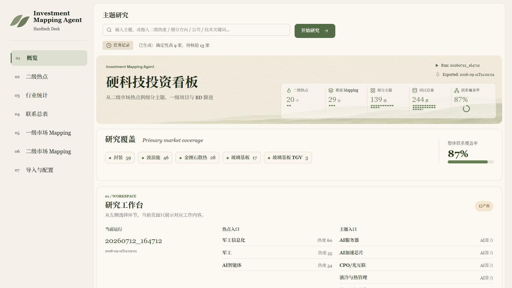

# 参考图界面

2026-11-03 按用户提供的界面稿更新。暖白纸色、橄榄绿、衬线字体、叶片标识与七项编号侧栏取自参考图。柔和选中位移和左侧竖线突出当前页面；减少动态效果设置会关闭动画。

指标图标可跳转现有页面。研究覆盖标签直接汇总已导入一级市场记录并可进入对应主题；联系覆盖进度跟随原指标数据，不填充示例值。保留原研究、任务记录、上传下载和筛选接口。

指标区已并入横幅右下角。概览之外的页面使用紧凑页头；手机端指标可横向滚动。数字带单位并弱化显示，点阵每格默认表示10个对应单位，末格按比例填充，超过400时提高每格单位以限制图形数量；悬停或辅助技术可读取比例说明。覆盖率圆环直接显示当前百分比。数值变更后图形重绘，减少动效设置关闭入场反馈。

山景为本项目生成的背景素材。图标来自 Lucide 0.468.0，随项目本地加载，授权文件位于 web/vendor/LICENSE-lucide。

旧页面拆为许多资源，浏览器并发加载时发现连接失败。服务将原样式和脚本按原顺序通过两个只读资源地址合并提供，连接队列扩展到128；原文件路径仍可使用。

验证：17项Python测试，以及七页、五个图标、选中状态、覆盖率、手机导航和减少动效设置的浏览器检查通过。视觉检查保留用户指定的暖白底、图标底色和较大的衬线标题，不以通用审美检查器覆盖参考图。

